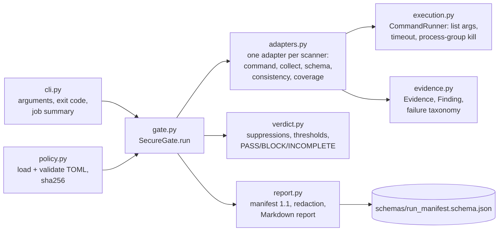

# SecureGate engine v2: architecture

**Branch:** `semester8-completion` · **Package:** `security_engine` · **Requirements:** [engine-requirements-v1.md](requirements/engine-requirements-v1.md) (v1.1)

## 1. What the engine does

SecureGate runs Semgrep (SAST), pip-audit (SCA) and Gitleaks (secrets), **checks whether each scanner's output can be trusted**, and then decides:

| Verdict | Exit | Meaning |
|---|---|---|
| PASS | 0 | Every required scanner produced valid evidence; nothing reached the blocking threshold |
| BLOCK | 1 | Valid evidence shows a finding at or above the threshold (or, under S0–S2, evidence was invalid) |
| INCOMPLETE | 2 | Under S3: a required scanner's evidence is missing or invalid, so security was not established |
| (policy/usage error) | 3 | Invalid policy file or command line; nothing was scanned |

## 2. Modules



| Module | Requirement groups | Responsibility |
|---|---|---|
| `execution.py` | FR-02, FR-03, FR-06, FR-09 | Starts a scanner with an argument list (never a shell), enforces the policy timeout by killing the process group, records exit code, output, timings and launch errors |
| `adapters.py` | FR-01, FR-04, FR-05, FR-07, FR-10–FR-17 | Per-scanner knowledge: pinned command, rule sources, where the report is, success exit codes, schema, exit/report consistency, coverage, finding normalisation. `STRATEGY_CHECKS` defines S0–S3 |
| `evidence.py` | FR-15, FR-18 | Evidence record per scanner (status, primary category, problems, findings, coverage, checks applied, validation time) |
| `policy.py` | FR-22, FR-24 | Strict TOML validation; defaults; per-scanner thresholds and timeouts; suppressions with expiry; canonical SHA-256 |
| `verdict.py` | FR-19–FR-21, FR-23–FR-25 | Deterministic decision from evidence + policy; reasons sorted; suppressions applied with notes |
| `gate.py` | FR-08, FR-26, NFR-07 | Orchestration: one fresh `raw/<run_id>/` folder per run, scanners independent, fail-safe ENGINE_ERROR, timing split |
| `report.py` | FR-27–FR-30 | Manifest 1.1, redaction of secrets and home paths, Markdown report |
| `cli.py` | FR-31–FR-33 | `python -m security_engine.cli`; strategy override for experiments; GitHub job summary |
| `engine.py`, `scanners/` | NFR-06 | The unchanged Semester 7 engine (`--legacy`) |

## 3. Evidence pipeline per scanner

```mermaid
flowchart TB
  R[run with timeout] -->|launch error / timeout| C1[TOOL_MISSING / LAUNCH_ERROR / TIMEOUT]
  R --> X{exit code in success codes?}
  X -->|no| C2[NONZERO_EXIT]
  X -->|yes| P{report present & non-empty?}
  P -->|no| C3[NO_OUTPUT]
  P -->|yes| J{valid JSON?}
  J -->|no| C4[INVALID_JSON]
  J -->|yes| S{schema valid?}
  S -->|no| C5[SCHEMA_INVALID]
  S -->|yes| K{exit code consistent with report?}
  K -->|no| C6[INCONSISTENT_EXIT]
  K -->|yes| V{coverage}
  V -->|nothing scanned| C7[NO_COVERAGE]
  V -->|part failed| C8[PARTIAL_COVERAGE]
  V -->|ok| OK[VALID evidence -> findings]
```



The strategy decides which of these checks run (S0: execution and exit code; S1: + presence, JSON, schema; S2/S3: + consistency and coverage) and what invalid evidence becomes (BLOCK under S0–S2, INCOMPLETE under S3). The checks applied are written to the manifest. Experiments change only the policy's strategy, never the code path (FR-23).

## 4. Outputs of one run

```
securegate-out/
  run_manifest.json     schema 1.1: run id, engine version, timings, target commit, policy (+sha256),
                        per scanner: version, command, exit code, stderr tail, rule sources, checks applied,
                        evidence status and category, coverage, validation time; findings; verdict and reasons
  report.md             human-readable report (also appended to the GitHub job summary)
  raw/<run_id>/         raw scanner reports of this run only (e.g. gitleaks-report.json)
```

## 5. CI integration

`.github/workflows/ci-security.yml`: **Tests → SecureGate → Docker build**. See [ci-integration.md](ci-integration.md).

## 6. Design rules that hold everywhere

- No path from an engine error or invalid evidence to PASS (NFR-02; `test_engine_error_never_passes`).
- Same evidence and policy → same verdict (FR-25).
- Scanner failures are independent; a valid scanner's findings are never dropped (FR-08, FR-20).
- Nothing is run through a shell (FR-09, checked by an AST test).
- Secrets and home paths are redacted from every output file (FR-29, checked by a test that scans every output file).
