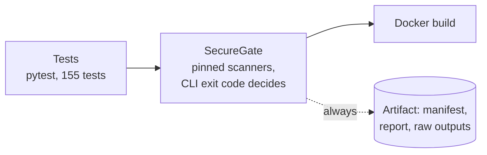

# CI integration

**Workflow:** `.github/workflows/ci-security.yml` (DEC-012) · **Triggers:** push to `main`, `securegate-development`, `semester8-*`; pull requests to `main` and `securegate-development`; manual dispatch.

## 1. Pipeline

| Job | Does | Fails when |
|---|---|---|
| Tests | `pip install -r requirements-dev.txt`; `pytest -q` (also validates the repository policy) | any test fails |
| SecureGate | installs Semgrep 1.180.0 and pip-audit 2.10.1 in their own venv and Gitleaks 8.30.1 (SHA-256 checked); runs `python -m security_engine.cli`; writes the verdict as a job annotation; validates the manifest against its JSON Schema; uploads the evidence; then enforces the exit code | exit 1 (BLOCK), 2 (INCOMPLETE) or 3 (policy/usage error) |
| Docker build | `docker build` | only runs after the gate job succeeds, i.e. PASS |

BLOCK and INCOMPLETE can never pass silently: the "Enforce gate verdict" step exits with the gate's code, and the Docker job `needs` the gate job. With `on_incomplete = "warn"` in the policy the gate itself returns 0 for INCOMPLETE; that is a visible, versioned policy choice (its hash is in the manifest), not a workflow setting.

## 2. Security of the workflow

- `permissions: contents: read` for the whole workflow; no secrets are used.
- `persist-credentials: false` on every checkout.
- Every action pinned to a full commit SHA (checkout v7.0.1, setup-python v7.1.0, upload-artifact v7.0.2).
- Scanner versions pinned; the Gitleaks binary verified with `sha256sum -c` before use.
- Scanners run from a separate virtual environment, so they cannot change the application's dependencies.
- Full history checkout (`fetch-depth: 0`) so Gitleaks scans history, not only the last commit.
- Evidence artifact kept 30 days; secrets in it are redacted by the engine (FR-29) and by Gitleaks (`--redact`).

## 3. Validation with real runs

Each validation branch is the completion branch plus one commit that changes `securegate.toml`. They are never merged.

| Branch | Change | Expected | Observed (run) |
|---|---|---|---|
| `semester8-completion` | none | PASS → Docker build runs | PASS, exit 0, Docker built ([44083975063](https://github.com/DuclasMatsinhe/SecureGate/actions/runs/44083975063); first run [44082447919](https://github.com/DuclasMatsinhe/SecureGate/actions/runs/44082447919)) |
| `semester8-ci-validate-block` | pip-audit pointed at `pip_audit_test_requirements.txt` (urllib3 1.26.5) | BLOCK, job fails, Docker skipped | BLOCK, exit 1, pip-audit BLOCKING_FINDING reasons, Docker skipped ([44082714889](https://github.com/DuclasMatsinhe/SecureGate/actions/runs/44082714889)) |
| `semester8-ci-validate-incomplete` | `executable = "semgrep-not-installed"` | INCOMPLETE, job fails, Docker skipped | INCOMPLETE, exit 2, `semgrep: TOOL_MISSING`, Docker skipped ([44082720043](https://github.com/DuclasMatsinhe/SecureGate/actions/runs/44082720043)) |
| `semester8-ci-validate-config` | `strategy = "S9"` | pipeline stops before the gate | Tests job failed (repository-policy test), gate and Docker skipped ([44083925171](https://github.com/DuclasMatsinhe/SecureGate/actions/runs/44083925171)). The gate's exit 3 is covered by unit tests and a local run (exit 3, "strategy must be one of S0, S1, S2, S3") |

The verdicts above were read from the public GitHub API (job conclusions and the "SecureGate verdict" annotation).

## 4. Making it a required check

To stop merges, mark the **SecureGate** job as a required status check in the branch protection of `main`. That is a repository-settings change and was not made; it needs the owner's approval.
